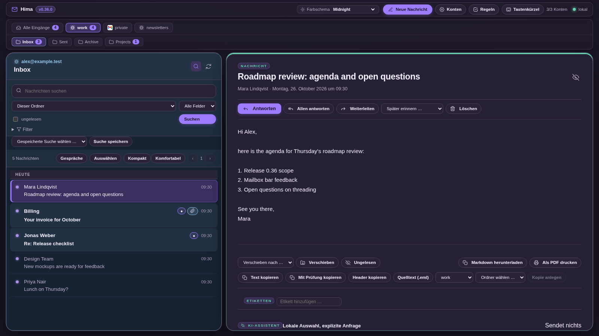
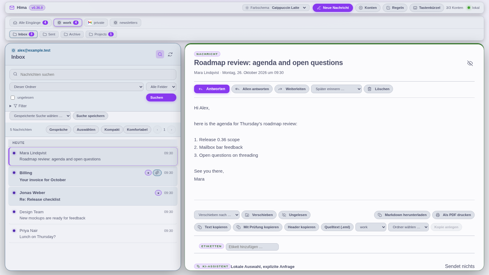

# Hima

> **Fast, private, local-first email client powered by the Himalaya CLI.**

Hima (formerly Himalaya Web) provides a desktop-grade browser interface for the [Himalaya](https://github.com/soywod/himalaya) CLI. It stays strictly bound to loopback (`127.0.0.1`), keeps your mail and credentials on your machine, and uses your existing desktop keyring and Himalaya account configuration.



<details><summary>Light theme (Catppuccin Latte)</summary>



</details>

---

## Highlights

- **Unified Multi-Account Inbox:** Seamlessly view, search, and manage emails across all your configured IMAP/JMAP/Maildir accounts in one unified stream.
- **Persistent Mailbox Bar:** All accounts and the open account's folders sit in a tab bar under the top bar (with unread counts and provider logos), so the list and the reader get the full width. The open mailbox's email address is always shown at the top of the message list.
- **Two-Pane Reading Layout:** Superhuman/Apple-Mail style two-line envelope summaries, collapsible search dock, and a focused reading pane.
- **Header-Based Threading:** Conversations are accurately grouped using standard `Message-ID`, `In-Reply-To`, and `References` headers.
- **Fast Local Search:** Search within a folder, across an entire account, or across all accounts with filters for date range, unread status, flagged messages, and attachments.
- **Privacy & Security First:**
  - Loopback-only binding (`127.0.0.1`) with session token verification and DNS rebinding protection.
  - Zero cloud tracking: remote images blocked by default with per-sender and per-message disclosure.
  - HTML emails sanitized with strict DOMPurify rules and isolated in sandboxed iframes.
  - No credentials stored in browser storage; passwords live in your OS keyring.
- **Power Tools:**
  - **Undo Send:** Configurable 10-second delayed outbox with instant cancellation.
  - **Local Labels & Snooze:** Tag and organize messages locally without mutating server flags.
  - **Draft Autosave:** Non-blocking localStorage draft recovery namespaced per message and account.
  - **Keyboard Navigation:** Full vim-style (`j`/`k`, `r`, `a`, `e`, `s`, `x`, `?`) keyboard shortcuts and `Ctrl+K` command palette.
  - **Themes:** Built-in Midnight, VS Code Dark, Catppuccin Mocha, Catppuccin Latte, Nord, and Tokyo Night.

---

## Prerequisites

1. **Node.js** (v22 or later recommended) and `npm`.
2. **Himalaya CLI** (v2.1.0 or later) installed and available on `$PATH`.
3. At least one email account configured in `~/.config/himalaya/config.toml`. Verify with:
   ```bash
   himalaya account list
   ```

---

## Quickstart

```bash
# 1. Clone the repository
git clone https://github.com/DnaMes/hima.git
cd hima

# 2. Install dependencies
npm install

# 3. Build client assets
npm run build

# 4. Start the server
npm start
```

The application will start on `http://127.0.0.1:47831/`. Open the URL in your browser to begin reading mail.

---

## Configuration & Environment

| Environment Variable | Default | Purpose |
|---|---|---|
| `HIMALAYA_WEB_PORT` | `47831` | Port to bind the loopback server to |
| `HIMALAYA_CONFIG_PATH` | `~/.config/himalaya/config.toml` | Custom path to Himalaya TOML config |
| `HIMALAYA_BIN` | `himalaya` | Path to the Himalaya binary |
| `HIMALAYA_WEB_ACCOUNTS_PATH` | `~/.config/himalaya-web/accounts.json` | Account preferences and ordering |
| `HIMALAYA_WEB_LABELS_PATH` | `~/.config/himalaya-web/labels.json` | Local message labels |
| `HIMALAYA_WEB_RULES_PATH` | `~/.config/himalaya-web/rules.json` | Local rules engine store |

---

## Running as a Systemd User Service

To run Hima automatically in the background on your Linux desktop:

```ini
# ~/.config/systemd/user/hima.service
[Unit]
Description=Hima Mail Client (loopback)
After=graphical-session.target

[Service]
Type=simple
WorkingDirectory=%h/projects/business/erdlabs/apps/hima
Environment=NODE_ENV=production
Environment=HIMALAYA_WEB_PORT=47831
ExecStart=/usr/bin/node node_modules/tsx/dist/cli.mjs src/server/index.ts
Restart=on-failure
RestartSec=3
NoNewPrivileges=true
PrivateTmp=true

[Install]
WantedBy=graphical-session.target
```

Enable and start the service:
```bash
systemctl --user daemon-reload
systemctl --user enable --now hima.service
```

---

## Development & Testing

```bash
# Run unit tests
npm test

# Run Playwright E2E tests
npm run test:e2e

# Run type check
npm run typecheck

# Run dev server with hot reload
npm run dev

# Re-render the README screenshots from synthetic data
SCREENSHOTS=1 npx playwright test tests/e2e/screenshots.spec.ts
```

Releases are cut from annotated `vX.Y.Z` tags; see [RELEASE.md](RELEASE.md) and [CHANGELOG.md](CHANGELOG.md).

---

## License

[MIT](LICENSE) © 2026 erdlabs / André Semek
